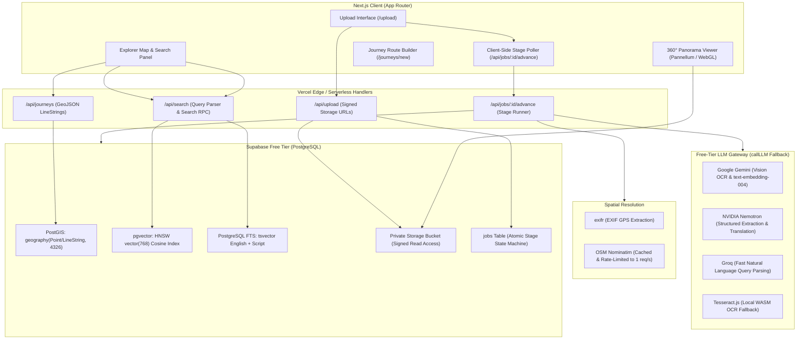
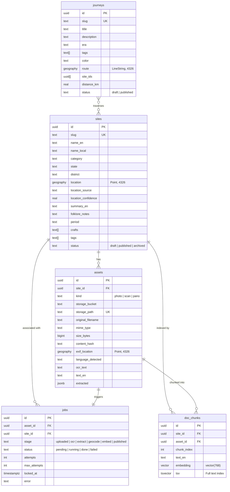

# Dharohar · धरोहर
### Digital Revitalisation of Unstructured Cultural & Architectural Heritage Archives

[](https://nextjs.org/)
[](https://supabase.com/)
[](https://maplibre.org/)
[](https://www.typescriptlang.org/)
[](LICENSE)

---

## 1. The Problem

Centuries of Indian architectural, epigraphic, and artisan traditions exist as **fragmented, unstructured records**:
- **Heterogeneous Media**: Fading palm-leaf and paper manuscripts, epigraphic stone rubbings, field photographs, architectural drawings, and colonial surveys.
- **Linguistic Barriers**: Inscriptions and documents written in ancient scripts (Devanagari, Old Gujarati, Sharada, Persian, regional dialects) that remain unindexed and untranslated for researchers and travelers.
- **Geographic Disconnect**: Archival records rarely link to verified geographic coordinates or spatial itineraries, leaving stepwells, rock-cut shrines, and textile guilds hidden from public exploration.
- **Infrastructure Constraints**: Non-profit cultural heritage platforms cannot afford heavy dedicated workers, GPU clusters, or costly proprietary API tiers.

---

## 2. The Solution

**Dharohar** ("Heritage" in Hindi) is a workerless web application that ingests unstructured heritage documents and photos, and revitalises them into an interactive digital atlas:

1. **Multilingual Ingestion**: Upload photos, architectural scans, and equirectangular 360° panoramas in Devanagari, Hindi, Gujarati, or English.
2. **Autonomous Multi-Stage Pipeline**: Verifies file integrity, extracts EXIF GPS, runs multilingual OCR with vision and neural fallbacks, performs structured JSON entity extraction, resolves historical locations with rate-limited Nominatim geocoding, and computes 768-dimensional vector embeddings.
3. **Interactive Heritage Atlas**: A vector-tile map displaying heritage pins, historical itineraries ("Journeys"), and equirectangular 360° virtual tours with interactive notes.
4. **Natural-Language Hybrid Search**: Search in plain English or regional terms (e.g., *"Solanki stepwells with Vishnu carvings near Patan"* or *"indigo mud resist printing"*); results blend full-text keyword matching (`tsvector`) with semantic vector similarity (`pgvector` cosine distance) and spatial proximity.
5. **Zero Dedicated Workers**: Operates entirely on free-tier infrastructure without Docker or Redis. Pipeline stages advance through client-driven idempotent polling calls against a Postgres job state machine.

---

## 3. System Architecture



---

## 4. Pipeline Stages: Workerless Idempotent Processing

Instead of running an expensive background worker daemon (such as Celery or BullMQ), Dharohar implements an **atomic state machine** backed by Postgres stored procedures (`claim_job_stage`, `complete_job_stage`, `fail_job_stage`). The web client or seed script polls `/api/jobs/[id]/advance`, executing exactly **one stage per call**:


| Stage | What Happens | Provider / Tool | Idempotency & Failure Handling |
| :--- | :--- | :--- | :--- |
| **`uploaded`** | Verifies file bytes, computes SHA-256 hash, extracts camera GPS via `exifr`, detects equirectangular 2:1 aspect ratio (`kind=pano`) using `sharp`. | `exifr`, `sharp`, Internal | Skips if hash already exists; creates signed storage path. |
| **`ocr`** | Transcribes Devanagari, Hindi, Gujarati, or English script. Produces both original script and English translation. | Gemini Vision → NVIDIA → Tesseract.js (WASM) | Cached by content hash in `llm_cache`; falls back to local WASM on timeout. |
| **`extract`** | Extracts structured metadata (title, category, state, district, period, crafts, folklore notes, field confidence). | NVIDIA Nemotron → Groq → Gemini | Validated against strict Zod schema; flags uncertain fields below threshold. |
| **`geocode`** | Resolves geographic coordinates: uses EXIF GPS first, then Nominatim geocoder, or flags `needs_manual_location`. | `exifr`, OpenStreetMap Nominatim | Enforces Postgres table mutex for $\le 1\text{ req/sec}$; caches responses in `geocode_cache`. |
| **`embed`** | Chunks translated English text and site summary into 768-dimensional semantic embeddings in `doc_chunks`. | Gemini `text-embedding-004` (768 dims) | `unique(asset_id, chunk_index)` prevents duplicate embeddings on re-run. |
| **`published`** | Updates site status to `published`, regenerates spatial bounds, and indexes for map discovery. | PostgreSQL PostGIS | Atomic status update; only runs if location is verified. |

---

## 5. Database Schema

The database uses PostgreSQL with `postgis` and `pgvector` extensions enabled.



---

## 6. Tech Stack & Architectural Decisions

| Layer | Technology | Why Chosen Over Alternatives |
| :--- | :--- | :--- |
| **Framework** | **Next.js 16 (App Router, Turbopack)** | Server Components provide fast initial HTML loads; Route Handlers run stateless pipeline stages on Vercel Hobby free tier. |
| **Database & GIS** | **Supabase (PostgreSQL + PostGIS + pgvector)** | Free tier includes PostGIS spatial indices (`geography(point, 4326)` and `geography(linestring, 4326)`) and HNSW vector search in one unified ACID store. |
| **Mapping Engine** | **MapLibre GL JS** | Open-source, zero API-key dependencies, completely free vector tile rendering, smooth WebGL pan/zoom on mobile. |
| **Multi-LLM Gateway** | **Gemini + NVIDIA Nemotron + Groq** | Eliminates vendor lock-in. Uses **Groq** for ultra-fast query classification, **NVIDIA Nemotron** for strict JSON extraction, and **Gemini** for multimodal OCR & 768-dim embeddings. Built-in circuit breaker and fallback. |
| **Local OCR Fallback**| **Tesseract.js (WASM)** | Runs inside Node without native binary compilation; ensures pipeline advances even if third-party LLMs hit rate limits or fail. |
| **Image Processing** | **Sharp** | High-performance C-lib image parsing in Node to detect 2:1 equirectangular panorama aspect ratios without external API overhead. |
| **Panorama Viewer**  | **Pannellum + WebGL Canvas Fallback** | Lightweight HTML5 WebGL sphere projection with interactive hotspot pins and zero heavy Three.js bundle overhead. |

---

## 7. Setup & Local Development

### Prerequisites
- **Node.js**: `v20.6.0` or higher (required for native `--env-file` support).
- **Supabase Account**: A free project created at [supabase.com](https://supabase.com).

### Step 1: Clone the Repository
```bash
git clone https://github.com/your-username/dharohar.git
cd dharohar
npm install
```

### Step 2: Supabase Database Setup
1. Open your Supabase Dashboard -> **SQL Editor**.
2. Run the migration scripts in numerical sequence from the [`sql/`](file:///Users/indrayadav/Desktop/iitgandhi/dharohar/sql/) directory:
   - `000_health.sql`
   - `001_schema.sql` (Creates core tables, PostGIS extensions, and RLS policies)
   - `001_seed_sites.sql` (Initial curated sites)
   - `001b_upload_fields.sql`
   - `002_search_fn.sql`
   - `003_llm_cache.sql`
   - `004_ocr_fields.sql`
   - `005_extract_fields.sql`
   - `006_geocode_fields.sql`
   - `007_nominatim_rate_limit.sql` (Enforces 1 req/s Nominatim lock)
   - `008_search_v2.sql` (Hybrid reciprocal rank fusion search)
   - `009_review_fields.sql`
   - `010_phase5_pano_journeys.sql` (Adds `pano` support, journeys table, and GeoJSON views)
3. Under **Storage**, create a new **Private Bucket** named `dharohar-assets` (or your chosen bucket name).

### Step 3: Configure Environment Variables
Copy `.env.example` to `.env.local`:
```bash
cp .env.example .env.local
```

Fill in the required configuration:

```ini
# ---------- Supabase Configuration ----------
NEXT_PUBLIC_SUPABASE_URL=https://YOUR_PROJECT_ID.supabase.co
NEXT_PUBLIC_SUPABASE_ANON_KEY=your_supabase_anon_key
SUPABASE_SERVICE_ROLE_KEY=your_supabase_service_role_key
SUPABASE_STORAGE_BUCKET=dharohar-assets

# ---------- LLM Provider Keys (All Free Tiers) ----------
# Google AI Studio: https://aistudio.google.com/
GEMINI_API_KEY=your_gemini_api_key
GEMINI_MODEL_OCR=gemini-1.5-flash
GEMINI_MODEL_EMBED=text-embedding-004

# NVIDIA NGC Build: https://build.nvidia.com/
NVIDIA_API_KEY=your_nvidia_api_key
NVIDIA_BASE_URL=https://integrate.api.nvidia.com/v1
NVIDIA_MODEL_EXTRACT=nvidia/nemotron-4-340b-instruct

# Groq Console: https://console.groq.com/
GROQ_API_KEY=your_groq_api_key
GROQ_BASE_URL=https://api.groq.com/openai/v1
GROQ_MODEL_QUERY_PARSE=llama-3.3-70b-versatile

# ---------- Routing Chains ----------
LLM_CHAIN_OCR=gemini,nvidia,groq
LLM_CHAIN_EXTRACT=nvidia,groq,gemini
LLM_CHAIN_QUERY_PARSE=groq,nvidia,gemini

# ---------- Geocoding & Tiles ----------
NOMINATIM_USER_AGENT=Dharohar-Revitalisation/1.0 (contact@yourdomain.com)
NEXT_PUBLIC_MAP_STYLE_URL=https://tiles.openfreemap.org/styles/liberty
```

### Step 4: Run the Application
```bash
npm run dev
```
Open [http://localhost:3000](http://localhost:3000) in your browser.

---

## 8. Batch Seeding Pipeline

Dharohar includes an automated CLI batch seed runner [`scripts/seed.ts`](file:///Users/indrayadav/Desktop/iitgandhi/dharohar/scripts/seed.ts) to ingest local collections of images and PDFs:

```bash
# 1. Preview items and metadata without executing (Dry run)
npm run seed -- --dir=seed/samples --csv=seed/metadata.csv --dry-run

# 2. Ingest folder with 2.5s throttling to respect free-tier rate limits
npm run seed -- --dir=seed/samples --csv=seed/metadata.csv --throttle-ms=2500

# 3. Resume interrupted ingestion (automatically skips already published files)
npm run seed -- --dir=seed/samples --csv=seed/metadata.csv
```

---

## 9. Scalability & System Limits

- **Workerless Concurrency**: Because the pipeline is driven by database-backed compare-and-swap claims (`claim_job_stage`), multiple clients can poll simultaneously without race conditions or duplicated LLM calls.
- **HNSW Vector Search**: `pgvector` indexing with `hnsw (embedding vector_cosine_ops)` performs approximate nearest-neighbor search in sub-50ms across tens of thousands of chunks without table scans.
- **Nominatim Compliance**: OpenStreetMap Nominatim restricts usage to a maximum of 1 request per second. Dharohar enforces this via PostgreSQL advisory locking in [`sql/007_nominatim_rate_limit.sql`](file:///Users/indrayadav/Desktop/iitgandhi/dharohar/sql/007_nominatim_rate_limit.sql), preventing IP bans.
- **Private Storage**: Storage assets are stored in private buckets; image URLs are generated on the server using short-lived signed URLs (1-hour TTL), protecting raw files from hotlinking.

---

## 10. Limitations & Edge Cases

1. **OCR on Damaged Epigraphy**: Highly eroded stone inscriptions or cursive Persian/Modi script may yield low confidence or fragmented output. Dharohar surfaces an `ocr_confidence` metric and preserves the original unedited scan side-by-side with the transcription.
2. **Geocoding Ambiguity**: Historical or vernacular place names (e.g., *"Chandravati"* or ancient Solanki capitals) may not resolve cleanly in modern OpenStreetMap data. When confidence is low, Dharohar flags `needs_manual_location = true` and prompts human review.
3. **Free-Tier LLM Rate Limits**: Free tiers on Groq and Google Gemini impose RPM (Requests Per Minute) and TPM (Tokens Per Minute) ceilings. The `callLLM` wrapper catches HTTP 429 errors and automatically backs off with exponential jitter.

---

## 11. Roadmap

- [x] **Phase 1**: Supabase schema, PostGIS, pgvector, MapLibre tile exploration.
- [x] **Phase 2**: Multi-provider LLM gateway (`callLLM`) with fallback (Gemini, NVIDIA, Groq).
- [x] **Phase 3**: Idempotent 6-stage pipeline (`uploaded -> ocr -> extract -> geocode -> embed -> published`).
- [x] **Phase 4**: Hybrid semantic search, reciprocal rank fusion, faceted filtering, and review UI.
- [x] **Phase 5**: 360° Panorama viewer with hotspot notes, journeys layer and route builder, responsive mobile drawer, loading skeletons, and accessibility contrast standards.
- [ ] **Phase 6 (Future)**:
  - Audio oral history transcription with Whisper for intangible folk tales.
  - Multilingual vector embeddings supporting direct Gujarati/Hindi cross-lingual queries.
  - Community crowd-curation mode with verified archivist edits.

---

## 12. Dataset Sources & Ethical Open Data Checklist

When sourcing heritage documents, inscriptions, and photographs, adhere to the following checklist:

### Sourcing Checklist
- [ ] **Public Domain Mark or CC-BY License**: Ensure items are marked Public Domain Mark (PDM 1.0), CC0, or CC-BY 4.0.
- [ ] **Cultural Sensitivity**: Do not upload unreleased sacred iconography or restricted tribal artifacts.
- [ ] **Attribution Integrity**: Maintain source archival accession numbers, library call numbers, and photographer credits.

### Recommended Open Heritage Repositories
1. **Archaeological Survey of India (ASI) / Epigraphia Indica**: Available on [archive.org](https://archive.org/) under Public Domain. Inscriptions and estampages of Gujarat and Rajasthan.
2. **National Mission on Manuscripts (NMM) / IGNCA**: Open access archival manuscripts in Devanagari, Sharada, and Sanskrit.
3. **Wikimedia Commons Heritage Surveys**:
   - `Category:Stepwells in Gujarat` & `Category:Stepwells in Rajasthan` (Rani ki Vav, Chand Baori, Adalaj).
   - High-resolution equirectangular 360° panoramas under CC-BY-SA.
4. **Metropolitan Museum of Art Open Access (CC0)**: 19th-century photographic surveys of Indian monuments (Bourne & Shepherd, Colin Murray).
5. **British Library Endangered Archives Programme (EAP)**: Digitized temple registers and regional mercantile records.

### Attribution Template
Record each ingested item in `seed/metadata.csv` using this format:

| Column | Example |
| :--- | :--- |
| `filename` | `rani-ki-vav-corridor.jpg` |
| `title` | `Rani ki Vav Stepwell Subterranean Pavilion` |
| `kind` | `photo` |
| `state` | `Gujarat` |
| `district` | `Patan` |
| `category` | `stepwell` |
| `period` | `11th century (Solanki dynasty)` |
| `source_url` | `https://commons.wikimedia.org/wiki/File:Rani_ki_vav_01.jpg` |
| `license` | `CC-BY-SA-4.0` |
| `attribution` | `Wikimedia Commons / Archaeological Survey of India` |
